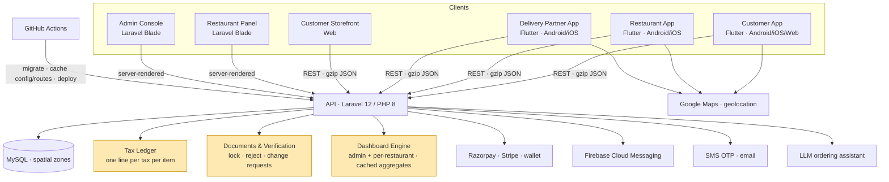

# Multi-Vendor Food Delivery Platform

A food delivery marketplace where customers order from local restaurants, restaurants run their kitchen and storefront, and delivery partners pick up and deliver. It runs on three Flutter apps (customer, restaurant, delivery partner), a customer storefront, a restaurant web panel and an admin console, all backed by one Laravel API. The engagement covered partner onboarding and document compliance, itemised GST across every bill, data privacy in the public API, end-to-end performance, and a redesign of all three apps and both web dashboards.

---

## Context

The client is a food delivery brand launching in India. Like most new entrants, it started from a licensed commercial multi-vendor codebase rather than building from zero. That codebase covers the common path (menus, carts, orders, riders), but not the parts a regulated Indian marketplace has to get right before it can scale: onboarding partners with the right legal documents, showing tax exactly as it is levied, keeping partner data out of public responses, and an experience that feels local and fast on Indian mobile networks.

Two things made it harder than "add features". First, three apps and two web panels all depend on the same API, so every backend change has to stay compatible with app versions already on phones. Second, the apps were being reviewed by the client continuously, so fixes had to land quickly without breaking a live system that restaurants and riders were already using.

## My Role

**Head of Engineering & Delivery (CTO), Vriksha Techno Solutions**

- Owned the architecture across seven surfaces: three mobile apps, the storefront, the restaurant panel, the admin console and the shared API.
- Designed the partner document workflow: admin-configured document sets, verification as a lock, per-document rejection with re-upload, and change requests after verification.
- Led the tax, privacy and performance work, each traced to a measured or reproduced root cause before any change shipped.
- Defined the release model: every push to `main` runs migrations and deploys, so every change is verified (tests, compile checks, rendered screenshots) before it is pushed.
- Ran delivery with AI coding agents under a governance method, the same one described in [vrix-concierge-build-story](https://github.com/ksanusha84/vrix-concierge-build-story). Work is split into non-overlapping file groups so agents can run in parallel, every change is verified independently of the agent that made it, and nothing is reported done until it has been checked.

## Architecture (high level)

## Tech Stack

- **Backend:** Laravel 12 (PHP 8.2+), Passport auth, modular packages for tax, reels and AI, Eloquent spatial for delivery zones
- **Database:** MySQL, with targeted composite indexes for per-restaurant date-range analytics
- **Mobile:** Flutter (GetX) for all three apps, Drift as the local response cache, Google Maps and geolocation
- **Web:** Laravel Blade for the admin console and restaurant panel, with a shared dashboard layer (server-built aggregates, client-side charts)
- **Payments:** Razorpay, Stripe, in-app wallet, cash on delivery with rider cash limits
- **Messaging:** Firebase Cloud Messaging, SMS OTP (Twilio), email
- **Documents:** PDF invoices and printable receipts with itemised GST, Excel exports
- **Delivery:** GitHub Actions. Every push to `main` runs migrations, rebuilds the config, route and event caches, and deploys

## Key Technical Decisions

**Partner documents are configuration, not schema.**
PAN, Aadhaar, driving licence, vehicle RC, FSSAI, GST and bank proof are defined as admin-configured registration fields, not new columns. The apps already rendered admin-defined fields, so the new document requirements reached riders and restaurants without an app release. The server enforces the mandatory ones, so a modified client can't skip them.

**Verification is a lock with an explicit workflow around it.**
Until admin verifies a partner, the partner can replace documents freely in the app. Admin can reject a single document with a reason; the partner is notified, re-uploads, and the document comes back for review. After verification, documents are locked and change only through a request with a reason, which admin approves (the file is swapped automatically) or rejects with a note. Every state is visible on both sides, so neither the partner nor admin has to ask where things stand.

**Private by default at the serialisation layer.**
An audit found that public restaurant listings returned each restaurant's bank account, IFSC, TIN and document links, and orders carried the rider's ID number. Rather than strip fields endpoint by endpoint, those attributes are hidden on the models themselves and opened only where the owner is the reader (the rider's own profile, a restaurant's own riders). A new endpoint can't leak them by accident.

**Tax is read from the ledger, never re-derived.**
Orders already stored one tax line per tax per item, but the apps only received a single "Tax" total. The calculation now returns each configured tax (for example CGST 2.5% and SGST 2.5%) with its share, and order responses sum the stored lines. Bills in every app, invoices, receipts, emails and the dashboards show exactly what admin configured. The parts always add up to the existing total, and older orders fall back to the single line.

**Measure latency before optimising it.**
Every API call took about a second, even for empty responses. Timing a static file against the API showed the server added only about 0.1 s; most of the cost was distance and a new TLS handshake on every request, because the app created a fresh HTTP client per call. Reusing one connection removed about 0.35 s per request, and gzip cut JSON payloads by 70–90%. The remaining distance is a hosting decision, documented for the client rather than hidden behind more code.

**Design systems first, screens second.**
Each app got a design system (theme, tokens and shared widgets) before any screen was touched, so every screen picked up the new look at once and later screen-by-screen polish stayed consistent. Screen groups were split across parallel agents with strict file ownership, and each screen was verified by compiling it and rendering it to a golden-test screenshot, since there was no device lab.

**One dashboard engine, scoped by who is looking.**
The admin dashboard (overview, live operations, finance, performance) is built from cached SQL aggregates with stale-while-refresh for heavy tabs. The restaurant panel reuses the same engine and views, scoped to one restaurant, with caches keyed by permission set so a limited employee never sees figures or links they can't open.

## Scale & Outcomes

- **7 surfaces** on one API: 3 Flutter apps, the storefront, the restaurant panel, the admin console and the API itself
- About **620,000 lines** across PHP, Blade and Dart: **150+ models**, **420+ migrations**, **360+ API routes** and **200+ app screens**
- Partner onboarding with legally required documents, verification, per-document rejection and change requests, live in admin and both partner apps
- Public API responses no longer expose partner bank details, tax IDs or identity documents
- GST itemised by tax name on every bill, invoice, receipt, email and dashboard
- Per-request latency down by about **0.35 s** from connection reuse, with JSON payloads **70–90% smaller** (for example 36 KB to 5.5 KB for restaurant lists)
- All three apps and both web dashboards redesigned to one visual language, with startup races and duplicate popups fixed along the way

*(Order volumes, revenue, partner counts and client-identifying details are confidential.)*

## What I'd Do Differently

- **Put the server next to the users from day one.** Hosting far from the customer base costs a round trip on every call. Connection reuse and compression hide much of it, but no code change removes it.
- **Test admin actions through the router, not the controller.** A route that took a value from a route default received its parameters swapped and returned 404 for every approve and reject. Tests that called the controller directly passed. Request-level tests would have caught it before release.
- **Treat API serialisation as an allowlist.** Sensitive fields leaked because responses included every column by default. Starting from "nothing is public unless listed" would have made the privacy fix unnecessary.
- **Set up release signing and a device test pass early.** Builds were verified by compilation, analysis and rendered screenshots, but startup timing issues only show up on real devices, and store releases need a release keystore that should exist from the first build.

## Note

This is a sanitized case study of production work delivered to a private client. Source code is not included due to confidentiality. The architecture, decisions and lessons reflect my direct engineering leadership on the project.
